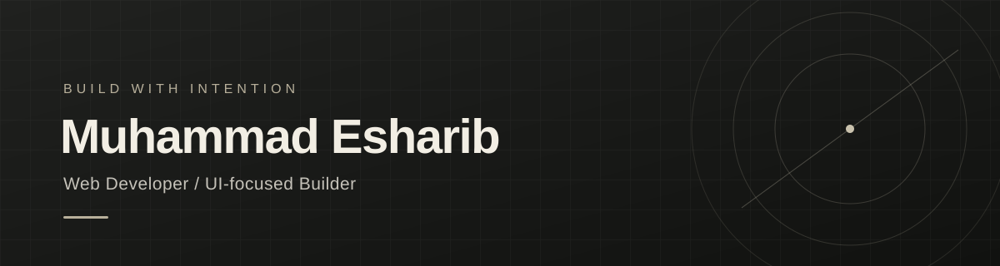

  

*I build interfaces that feel considered: fast, responsive, and a little bit alive.*  
*I'm a student at Iqra University, now learning the other half of the job, Linux and cyber security, so what I ship is secure by default.*  
*I'd rather ship a small thing properly than announce a big one.*

  <a href="#now"><b>NOW</b></a> &nbsp;·&nbsp;
  <a href="#selected-work"><b>WORK</b></a> &nbsp;·&nbsp;
  <a href="#highlights"><b>HIGHLIGHTS</b></a> &nbsp;·&nbsp;
  <a href="#stack"><b>STACK</b></a> &nbsp;·&nbsp;
  <a href="#github-activity"><b>ACTIVITY</b></a> &nbsp;·&nbsp;
  <a href="#contact"><b>CONTACT</b></a>

---

## Now

**frontend and AI** 
﹂**Student at Iqra University**, BS Cyber Security 
&emsp;﹂building client and personal projects with React, Next.js, TypeScript and Tailwind 
&emsp;﹂wiring AI features into real apps, with modern design systems underneath

**learning** 
﹂**Cyber security and Linux** 
&emsp;﹂web application security, secure development, command-line fundamentals

**teaching** 
﹂**AI tools, prompt engineering, computer basics and video editing** 
&emsp;﹂plus my own educational content

**Work with me:** freelance frontend and collaborations → [muhammadesharib1@gmail.com](mailto:muhammadesharib1@gmail.com)

---

## Selected work

| [**Portfolio**](https://github.com/MuhammadEsharib/Portfolio) Interactive portfolio with 3D, motion and smooth scroll React 19 · TypeScript · Three.js · GSAP · Lenis   | [**Robin Travels**](https://github.com/MuhammadEsharib/Robin-Travels) Travel-agency site with destination discovery, trip planning, FAQs and inquiry flows · [live](https://robin-travels-journey.lovable.app/) React · TypeScript · Tailwind CSS · GSAP   |
|---|---|
| [**AEHTER**](https://github.com/MuhammadEsharib/AEHTER) React and TypeScript web app with a Gemini AI integration · [live](https://aehter.vercel.app/) React · TypeScript · Vite · Gemini API   | [**ApplyFlow**](https://github.com/MuhammadEsharib/applyflow) Job-search platform for organising applications, resumes and career tasks · [live](https://applyflow-livid.vercel.app/) React · TypeScript · Vite · Tailwind CSS   |

  <a href="https://github.com/MuhammadEsharib?tab=repositories"><b>All repositories ↗</b></a>

---

## Highlights

| Highlight | Detail |
|---|---|
| **Frontend for clients** | Build production-level frontend projects for clients: responsive, component-based, shipped on Vercel |
| **AI integrations** | [AEHTER](https://github.com/MuhammadEsharib/AEHTER) puts the Gemini API inside a React + TypeScript app; I build AI features into interfaces, not just chat boxes |
| **Motion and 3D** | [Portfolio](https://github.com/MuhammadEsharib/Portfolio) combines Three.js, GSAP and Lenis smooth scroll on React 19 |
| **Full-stack range** | Next.js, Node.js, MongoDB and Supabase alongside the frontend work |
| **Educator** | Teach AI tools, prompt engineering, computer basics and video editing, and create my own educational content |
| **Security path** | BS Cyber Security at Iqra University; learning Linux and web application security through coursework, independent study and hands-on practice |

---

## Stack

<table>
  <tr>
    <td width="18%"><b>Frontend</b></td>
    <td>
      
      
      
      
      
      
      
    </td>
  </tr>
  <tr>
    <td><b>Backend and data</b></td>
    <td>
      
      
      
    </td>
  </tr>
  <tr>
    <td><b>Motion</b></td>
    <td>
      
      
    </td>
  </tr>
  <tr>
    <td><b>Tooling</b></td>
    <td>
      
      
      
    </td>
  </tr>
  <tr>
    <td><b>Learning</b></td>
    <td>
      
      
      
    </td>
  </tr>
</table>

---

## GitHub activity

  

  
<b>Languages and repositories</b>

  

    
  

  

    
  

  Language share reflects code detected in public repositories, not proficiency.

Generated with <a href="https://github.com/lowlighter/metrics">lowlighter/metrics</a> and refreshed by GitHub Actions.

---

## Contact

  <a href="https://www.linkedin.com/in/muhammadesharib/"><b>LinkedIn</b></a> &nbsp;·&nbsp;
  <a href="mailto:muhammadesharib1@gmail.com"><b>Email</b></a> &nbsp;·&nbsp;
  <a href="https://github.com/MuhammadEsharib"><b>GitHub</b></a>

  Software · Security · Design

