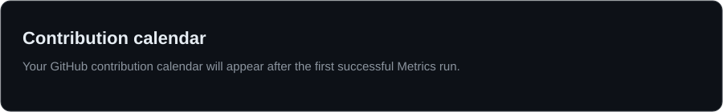
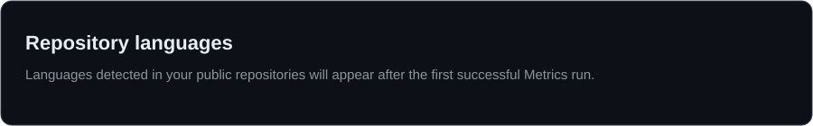
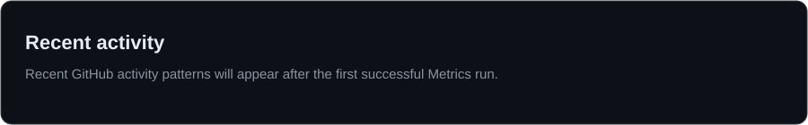

  

  

    <a href="https://www.linkedin.com/in/muhammadesharib/">LINKEDIN</a>
    &nbsp;·&nbsp;
    <a href="mailto:muhammadesharib1@gmail.com">EMAIL</a>
    &nbsp;·&nbsp;
    <a href="https://github.com/MuhammadEsharib">GITHUB</a>
  

  <h2>Work with intention. Build with consistency.</h2>
  
Web development · Interface design · Practical AI

---

## About

I'm Muhammad Esharib, a Computer Science student and web developer.

I enjoy turning ideas into useful digital experiences. I like understanding the problem first, planning a clear solution, building it carefully, and improving it through testing and feedback.

My current interests are frontend development, interface design, and learning how to build complete web applications. I value steady progress, honest communication, and doing the fundamentals well.

## Selected work

<table>
  <tr>
    <td width="50%" valign="top">
      <h3><a href="https://github.com/MuhammadEsharib/Portfolio">Portfolio</a></h3>
      
A personal portfolio built around interactive visuals, motion, and 3D web experiences.

      React 19 · TypeScript · Three.js · GSAP · Lenis
      
<a href="https://github.com/MuhammadEsharib/Portfolio">VIEW SOURCE ↗</a>

    </td>
    <td width="50%" valign="top">
      <h3><a href="https://github.com/MuhammadEsharib/Robin-Travels">Robin Travels</a></h3>
      
A travel-agency website with destination discovery, trip planning, FAQs, and inquiry flows.

      React · TypeScript · Tailwind CSS · GSAP
      
<a href="https://robin-travels-journey.lovable.app/">LIVE WEBSITE ↗</a> · <a href="https://github.com/MuhammadEsharib/Robin-Travels">SOURCE ↗</a>

    </td>
  </tr>
  <tr>
    <td width="50%" valign="top">
      <h3><a href="https://github.com/MuhammadEsharib/AEHTER">AEHTER</a></h3>
      
An AI-powered web application built with React and TypeScript, with a Gemini integration.

      React 19 · TypeScript · Vite · Gemini API
      
<a href="https://aehter.vercel.app/">LIVE WEBSITE ↗</a> · <a href="https://github.com/MuhammadEsharib/AEHTER">SOURCE ↗</a>

    </td>
    <td width="50%" valign="top">
      <h3><a href="https://github.com/MuhammadEsharib/applyflow">ApplyFlow</a></h3>
      
A job-search platform concept for tracking applications, preparing resumes, and organising career tasks.

      React 19 · TypeScript · Vite · Tailwind CSS
      
<a href="https://applyflow-livid.vercel.app/">LIVE WEBSITE ↗</a> · <a href="https://github.com/MuhammadEsharib/applyflow">SOURCE ↗</a>

    </td>
  </tr>
</table>

## GitHub activity

The reports below are generated from public GitHub data by [lowlighter/metrics](https://github.com/lowlighter/metrics). GitHub Actions refreshes them automatically.

  

<table>
  <tr>
    <td width="50%" valign="top">
      
    </td>
    <td width="50%" valign="top">
      
    </td>
  </tr>
</table>

Repository language data is not a measure of proficiency. GitHub activity reflects recorded events, not every hour spent learning or working.

## Tools and technologies

  
  
  
  
  
  
  
  
  
  

I use these technologies across my projects and continue to strengthen my understanding through practice.

## Principles I try to follow

  
<strong>Consistency over shortcuts</strong>

  
Make steady progress, learn from mistakes, and improve the work instead of rushing just to finish.

  
<strong>Purpose before decoration</strong>

  
Understand what a product needs to do before adding visual effects or complexity. Design should support the experience.

  
<strong>Honest work</strong>

  
Represent skills and project features accurately. Be clear about what is finished, what is experimental, and what still needs improvement.

  
<strong>Keep learning</strong>

  
Practise the fundamentals, stay curious, and approach difficult problems with patience.

## Currently learning

- Building maintainable frontend applications
- Understanding backend development and APIs
- Improving accessibility, performance, and responsive design
- Exploring practical AI integrations

## Get in touch

I'm open to learning opportunities, useful collaborations, and conversations about building thoughtful digital products.

  
  

  Built with care. Improved with consistency.

