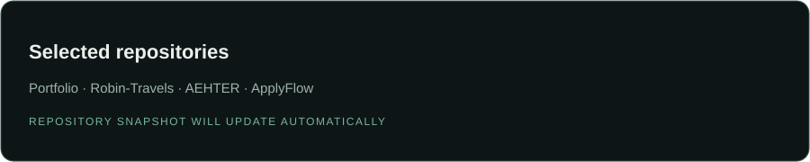

  

  

    <a href="#about"><b>ABOUT</b></a>
    &nbsp;·&nbsp;
    <a href="#selected-work"><b>WORK</b></a>
    &nbsp;·&nbsp;
    <a href="#stack"><b>STACK</b></a>
    &nbsp;·&nbsp;
    <a href="#github-activity"><b>ACTIVITY</b></a>
    &nbsp;·&nbsp;
    <a href="#contact"><b>CONTACT</b></a>
  

  <h3>I build clear, fast interfaces, and I'm learning how to keep them secure.</h3>

 

<table>
  <tr>
    <td width="33%" valign="top">
      <b>Building</b> 
      Responsive web apps with React, TypeScript and motion
    </td>
    <td width="33%" valign="top">
      <b>Studying</b> 
      BS Cyber Security at Iqra University
    </td>
    <td width="33%" valign="top">
      <b>Open to</b> 
      Collaboration, freelance frontend work, learning opportunities
    </td>
  </tr>
</table>

---

## About

I'm a frontend developer based in Karachi, studying **Cyber Security** at **Iqra University**. I like the whole loop: understand the problem, plan the interface, build it, test it, then polish the details.

I build frontend projects for clients and personal use, mostly in React and TypeScript. Alongside that, I'm building a foundation in **web application security** and secure development, so the things I ship are not just good-looking but also safer by default.

I also teach practical AI tools, prompt engineering, computer basics and video editing, and I create my own educational content.

I'd rather be accurate about what I know than overstate it, and I keep learning in public through real projects.

## Selected work

A few public projects. Each links to its source code and, where available, a live version.

<table>
  <tr>
    <td width="50%" valign="top">

**Portfolio** 
A personal portfolio exploring interactive visuals, motion and 3D. 
React 19 · TypeScript · Three.js · GSAP · Lenis 
[Source code](https://github.com/MuhammadEsharib/Portfolio)

</td>
    <td width="50%" valign="top">

**Robin Travels** 
A travel-agency website with destination discovery, trip planning, FAQs and inquiry flows. 
React · TypeScript · Tailwind CSS · GSAP 
[Live site](https://robin-travels-journey.lovable.app/) · [Source code](https://github.com/MuhammadEsharib/Robin-Travels)

</td>
  </tr>
  <tr>
    <td width="50%" valign="top">

**AEHTER** 
A React and TypeScript web app with a Gemini AI integration. 
React · TypeScript · Vite · Gemini API 
[Live site](https://aehter.vercel.app/) · [Source code](https://github.com/MuhammadEsharib/AEHTER)

</td>
    <td width="50%" valign="top">

**ApplyFlow** 
A job-search platform for organising applications, resumes and career tasks. 
React · TypeScript · Vite · Tailwind CSS 
[Live site](https://applyflow-livid.vercel.app/) · [Source code](https://github.com/MuhammadEsharib/applyflow)

</td>
  </tr>
</table>

  <a href="https://github.com/MuhammadEsharib?tab=repositories"><b>Browse all repositories ↗</b></a>

---

## Stack

<table>
  <tr>
    <td width="18%"><b>Frontend</b></td>
    <td>
      
      
      
      
      
      
    </td>
  </tr>
  <tr>
    <td><b>Motion &amp; 3D</b></td>
    <td>
      
      
    </td>
  </tr>
  <tr>
    <td><b>Tooling</b></td>
    <td>
      
      
      
    </td>
  </tr>
  <tr>
    <td><b>Learning</b></td>
    <td>
      
      
      
    </td>
  </tr>
</table>

  
<b>How I work</b>

   

- Understand the problem before choosing a solution.
- Keep the code clear and maintainable.
- Prefer useful features over decoration.
- Test changes, learn from mistakes, and describe my skills honestly.

  
<b>Current learning priorities</b>

   

- Building maintainable frontend and full-stack applications
- Improving accessibility, performance and responsive behaviour
- Strengthening programming and software engineering fundamentals
- Studying cybersecurity fundamentals and web application security
- Learning to identify, understand and communicate technical risks responsibly

---

## GitHub activity

  

  
<b>Languages and repositories</b>

  

    
  

  

    
  

  Language share reflects code detected in public repositories. It is not a measure of proficiency.

Reports are generated with <a href="https://github.com/lowlighter/metrics">lowlighter/metrics</a> and refreshed by GitHub Actions. Contributions show recorded activity, not every hour spent studying or planning.

---

## Contact

If you're working on something in web development, design or security and want to talk, I'd like to hear from you.

  
  

  Software · Security · Design

